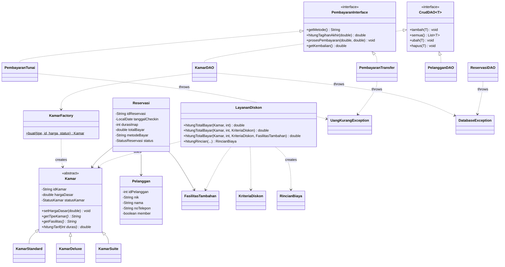

# PROPOSAL PROYEK PEMROGRAMAN BERORIENTASI OBJEK (PBO)

## JUDUL APLIKASI: GRAND HOTEL MANAGEMENT SYSTEM (GHMS)

**Tema (No. 5): Reservasi Hotel**: hierarki `Kamar → Standard, Deluxe, Suite`; polimorfisme `hitungTarif()` dengan fasilitas dan diskon berbeda per tipe kamar.

### 0. IDENTITAS KELOMPOK

| No | Nama | NIM | Peran Utama |
|---|---|---|---|
| 1 | [Nama Anggota 1] | [NIM] | Model & Logika Bisnis OOP |
| 2 | [Nama Anggota 2] | [NIM] | Data Layer (SQLite, DAO) & Tab Pelanggan/Riwayat |
| 3 | [Nama Anggota 3] | [NIM] | GUI (FXML/CSS), Controller, Navigasi |

Pembagian kerja rinci dan aturan Git ada pada **Bagian 6**.

---

### 1. PENDAHULUAN DAN LATAR BELAKANG

#### 1.1 Deskripsi Proyek

**Grand Hotel Management System (GHMS)** adalah aplikasi desktop internal berbasis GUI untuk mendukung operasional harian admin/resepsionis hotel. Aplikasi mencakup pengelolaan data kamar, pencatatan data tamu, perhitungan biaya reservasi dengan diskon bertingkat (tipe kamar, member, kode promo) dan fasilitas tambahan, pembayaran (Tunai/Transfer Bank), pencetakan struk ke file `.txt`, serta riwayat reservasi dan proses *check-out*.

#### 1.2 Lingkup Pengguna (User Scope)

Aplikasi adalah **sistem operasional internal (Front-Desk System)**. Seluruh interaksi dilakukan oleh **Admin/Resepsionis** yang login. Tamu tidak login; tamu diperlakukan sebagai entitas data yang dikelola admin.

#### 1.3 Spesifikasi Teknologi

* **Bahasa:** Java (JDK 17)
* **Framework GUI:** JavaFX (FXML + CSS)
* **IDE:** Eclipse (sesuai ketentuan tugas). Pustaka JavaFX ditambahkan sebagai *User Library* dan VM arguments `--module-path <path-javafx>/lib --add-modules javafx.controls,javafx.fxml`.
* **Arsitektur:** Model-View-Controller (MVC) + lapisan DAO
* **Basis Data:** SQLite (`sqlite-jdbc`), file `hotel_reservasi.db`
* **Version Control:** Git & GitHub (aturan kerja pada Bagian 6)

---

### 2. DESKRIPSI FITUR UTAMA APLIKASI

1. **Login Admin.** Autentikasi dengan data di tabel `admin` (password disimpan sebagai hash SHA-256, bukan teks biasa).
2. **CRUD Kamar (Entitas 1).** Tambah, lihat, ubah, hapus kamar: ID, tipe (Standard/Deluxe/Suite), tarif dasar per malam, status (Tersedia/Terisi). Ditampilkan di `TableView`, dilengkapi **pencarian dan filter status**.
3. **CRUD Pelanggan (Entitas 2).** Tambah, lihat, ubah, hapus tamu: NIK (16 digit), nama lengkap, nomor telepon, status keanggotaan (Member/Non-Member). Ditampilkan di `TableView`, dilengkapi **pencarian** (NIK/nama/telepon).
4. **Reservasi Baru & Perhitungan Tarif Polimorfik.** Memilih tamu dan kamar tersedia, tanggal check-in, durasi, fasilitas tambahan (Sarapan/Extra Bed), dan kode promo. Biaya dihitung otomatis dengan rincian: diskon tipe kamar, diskon member (otomatis dari data tamu), potongan promo, dan biaya fasilitas.
5. **Pembayaran.** Metode **Tunai** dan **Transfer Bank** (dua kelas yang mengimplementasikan interface yang sama), dengan *custom exception* `UangKurangException` bila nominal kurang. Setelah sukses, struk ditampilkan dan dapat disimpan ke file `.txt`.
6. **Riwayat Reservasi & Check-out.** Tabel seluruh reservasi (dengan pencarian) dan tombol *Check-out* yang mengubah status kamar kembali menjadi Tersedia.
7. **Penyimpanan Permanen.** Semua perubahan langsung tersimpan di SQLite melalui DAO.

---

### 3. ARCHITECTURAL DESIGN & PENERAPAN KONSEP OOP

#### 3.1 Arsitektur MVC dan Struktur Package

```
                  ┌────────────────────────┐
                  │    Controller (Java)   │
                  │ (Event Handling, validasi│
                  │  input, navigasi)      │
                  └───┬────────────────┬───┘
        (User Input / │                │ (Panggil logika /
         Trigger Event)│                │  perbarui tampilan)
                      ▼                ▼
┌────────────────────────┐          ┌────────────────────────────────┐
│     View (JavaFX)      │          │            Model               │
│ .fxml + CSS + Dialog   │          │ Entitas OOP, Logika Bisnis,    │
│ (tanpa logika bisnis)  │          │ DAO + SQLite                   │
└────────────────────────┘          └────────────────────────────────┘
```

```
ghms/
├── model/        Kamar, KamarStandard, KamarDeluxe, KamarSuite, StatusKamar, KamarFactory,
│                 Pelanggan, Admin, Reservasi, StatusReservasi, KriteriaDiskon,
│                 FasilitasTambahan, RincianBiaya, LayananDiskon,
│                 PembayaranInterface, PembayaranTunai, PembayaranTransfer,
│                 UangKurangException, DatabaseException
├── dao/          CrudDAO<T>, KamarDAO, PelangganDAO, ReservasiDAO, AdminDAO, DatabaseHelper
├── controller/   LoginController, MainController, MenuBarController, KamarTabController,
│                 PelangganTabController, ReservasiTabController, RiwayatTabController,
│                 PaymentController, KamarFormController, PelangganFormController
├── util/         PasswordUtil, SceneNavigator
├── view/         *.fxml, style.css
└── MainApp.java
```

#### 3.2 Class Diagram Awal



*(Diagram Mermaid dapat dirender di GitHub/VS Code. Versi final dibuat ulang sebagai gambar UML pada laporan.)*

#### 3.3 Abstraksi & Pewarisan (Inheritance)

Satu *abstract class* `Kamar` dengan tiga method abstrak (`getTipeKamar`, `getFasilitas`, `hitungTarif`) diturunkan ke tiga kelas. Setiap konstruktor turunan memanggil `super(...)`.

```java
public enum StatusKamar { TERSEDIA, TERISI }

// Kelas Induk (Abstract Class), enkapsulasi penuh
public abstract class Kamar {
    private String idKamar;
    private double hargaDasar;
    private StatusKamar statusKamar;

    protected Kamar(String idKamar, double hargaDasar, StatusKamar statusKamar) {
        setIdKamar(idKamar);
        setHargaDasar(hargaDasar);
        setStatusKamar(statusKamar);
    }

    // Setter dengan validasi (final agar aman dipanggil dari konstruktor)
    public final void setIdKamar(String idKamar) {
        if (idKamar == null || !idKamar.matches("[A-Z]{3}-\\d{3}")) {
            throw new IllegalArgumentException("ID kamar harus berformat XXX-123, contoh: DLX-201");
        }
        this.idKamar = idKamar;
    }

    public final void setHargaDasar(double hargaDasar) {
        if (hargaDasar < 0) {
            throw new IllegalArgumentException("Harga kamar tidak boleh bernilai negatif!");
        }
        this.hargaDasar = hargaDasar;
    }

    public final void setStatusKamar(StatusKamar statusKamar) {
        if (statusKamar == null) {
            throw new IllegalArgumentException("Status kamar wajib diisi!");
        }
        this.statusKamar = statusKamar;
    }

    public String getIdKamar() { return idKamar; }
    public double getHargaDasar() { return hargaDasar; }
    public StatusKamar getStatusKamar() { return statusKamar; }

    protected void validasiDurasi(int durasi) {
        if (durasi <= 0) {
            throw new IllegalArgumentException("Durasi inap minimal 1 malam!");
        }
    }

    // Method abstrak untuk Polimorfisme
    public abstract String getTipeKamar();
    public abstract String getFasilitas();
    public abstract double hitungTarif(int durasi);
}
```

```java
public class KamarStandard extends Kamar {
    public KamarStandard(String id, double harga, StatusKamar status) {
        super(id, harga, status);                       // pemanggilan super pada konstruktor
    }
    @Override public String getTipeKamar() { return "Standard"; }
    @Override public String getFasilitas() { return "AC, TV, Wi-Fi"; }

    @Override
    public double hitungTarif(int durasi) {             // flat rate, tanpa diskon
        validasiDurasi(durasi);
        return getHargaDasar() * durasi;
    }
}

public class KamarDeluxe extends Kamar {
    public KamarDeluxe(String id, double harga, StatusKamar status) {
        super(id, harga, status);
    }
    @Override public String getTipeKamar() { return "Deluxe"; }
    @Override public String getFasilitas() { return "AC, TV, Wi-Fi, Minibar, Balkon"; }

    @Override
    public double hitungTarif(int durasi) {             // diskon 10% bila >= 3 malam
        validasiDurasi(durasi);
        double total = getHargaDasar() * durasi;
        return (durasi >= 3) ? total * 0.90 : total;
    }
}

public class KamarSuite extends Kamar {
    public KamarSuite(String id, double harga, StatusKamar status) {
        super(id, harga, status);
    }
    @Override public String getTipeKamar() { return "Suite"; }
    @Override public String getFasilitas() { return "AC, Smart TV, Wi-Fi, Minibar, Ruang Tamu, Bathtub"; }

    @Override
    public double hitungTarif(int durasi) {             // progresif: 15% (>=3), 20% (>=5)
        validasiDurasi(durasi);
        double total = getHargaDasar() * durasi;
        if (durasi >= 5) return total * 0.80;
        if (durasi >= 3) return total * 0.85;
        return total;
    }
}
```

`KamarFactory` memetakan nilai kolom `tipe_kamar` di database menjadi objek subclass yang tepat (dipakai `KamarDAO` dan form kamar):

```java
public final class KamarFactory {
    private KamarFactory() {}

    public static Kamar buat(String tipe, String id, double harga, StatusKamar status) {
        return switch (tipe) {
            case "Standard" -> new KamarStandard(id, harga, status);
            case "Deluxe"   -> new KamarDeluxe(id, harga, status);
            case "Suite"    -> new KamarSuite(id, harga, status);
            default -> throw new IllegalArgumentException("Tipe kamar tidak dikenal: " + tipe);
        };
    }
}
```

#### 3.4 Enkapsulasi pada Entitas Lain

Seluruh atribut bersifat `private`; akses melalui getter/setter yang memuat validasi.

```java
public class Pelanggan {
    private int idPelanggan;           // dibuat otomatis oleh database
    private String nik;
    private String nama;
    private String noTelepon;
    private boolean member;

    public Pelanggan(String nik, String nama, String noTelepon, boolean member) {
        setNik(nik);
        setNama(nama);
        setNoTelepon(noTelepon);
        this.member = member;
    }

    public void setNik(String nik) {
        if (nik == null || !nik.matches("\\d{16}")) {
            throw new IllegalArgumentException("NIK harus terdiri dari 16 digit angka!");
        }
        this.nik = nik;
    }
    public void setNama(String nama) {
        if (nama == null || nama.isBlank()) {
            throw new IllegalArgumentException("Nama pelanggan tidak boleh kosong!");
        }
        this.nama = nama.trim();
    }
    public void setNoTelepon(String noTelepon) {
        if (noTelepon == null || !noTelepon.matches("\\d{10,13}")) {
            throw new IllegalArgumentException("Nomor telepon harus 10-13 digit angka!");
        }
        this.noTelepon = noTelepon;
    }
    public void setMember(boolean member) { this.member = member; }
    public void setIdPelanggan(int id) { this.idPelanggan = id; }

    public int getIdPelanggan() { return idPelanggan; }
    public String getNik() { return nik; }
    public String getNama() { return nama; }
    public String getNoTelepon() { return noTelepon; }
    public boolean isMember() { return member; }
}
```

Kelas `Reservasi` (idReservasi, `Pelanggan`, `Kamar`, tanggal check-in `LocalDate`, durasi >= 1, `FasilitasTambahan`, kode promo, metode bayar, total bayar >= 0, `StatusReservasi`) dan `Admin` (username, passwordHash) memakai pola yang sama: atribut `private` dengan setter tervalidasi.

#### 3.5 Polimorfisme (Overriding & Overloading)

* **Overriding:** `LayananDiskon` memanggil `kamar.hitungTarif(durasi)` melalui **referensi kelas induk `Kamar`**. Perilaku (flat / 10% / progresif) ditentukan oleh tipe objek konkretnya. `getFasilitas()` di-*override* dengan cara yang sama untuk menampilkan fasilitas per tipe.
* **Overloading:** `LayananDiskon.hitungTotalBayar` memiliki **3 versi** dengan jumlah parameter berbeda.

```java
public class KriteriaDiskon {
    private final boolean member;
    private final String kodePromo;

    public KriteriaDiskon(boolean member, String kodePromo) {
        this.member = member;
        this.kodePromo = kodePromo;
    }
    public boolean isMember() { return member; }
    public String getKodePromo() { return kodePromo; }
}

public class FasilitasTambahan {
    public static final double TARIF_SARAPAN = 50_000;     // per malam
    public static final double TARIF_EXTRA_BED = 100_000;  // per malam
    private final boolean sarapan;
    private final boolean extraBed;

    public FasilitasTambahan(boolean sarapan, boolean extraBed) {
        this.sarapan = sarapan;
        this.extraBed = extraBed;
    }
    public boolean isSarapan() { return sarapan; }
    public boolean isExtraBed() { return extraBed; }

    public double hitungBiaya(int durasi) {
        double perMalam = (sarapan ? TARIF_SARAPAN : 0) + (extraBed ? TARIF_EXTRA_BED : 0);
        return perMalam * durasi;
    }
}

// Value object rincian biaya (record: field private final, diakses lewat accessor)
public record RincianBiaya(double subtotalKamar, double diskonTipe, double diskonMember,
                           double potonganPromo, double biayaFasilitas) {
    public double total() {
        return subtotalKamar - diskonTipe - diskonMember - potonganPromo + biayaFasilitas;
    }
}
```

```java
public class LayananDiskon {
    private static final double DISKON_MEMBER = 0.05;
    // Collection generik: kode promo -> potongan (Rp)
    private static final Map<String, Double> DAFTAR_PROMO =
            Map.of("PROMO2026", 50_000.0, "HEMAT100", 100_000.0);

    // Overload 1: tarif dasar tanpa kriteria tambahan
    public double hitungTotalBayar(Kamar kamar, int durasi) {
        return hitungRincian(kamar, durasi, null, null).total();
    }

    // Overload 2: dengan kriteria diskon (member + promo)
    public double hitungTotalBayar(Kamar kamar, int durasi, KriteriaDiskon kriteria) {
        return hitungRincian(kamar, durasi, kriteria, null).total();
    }

    // Overload 3: dengan kriteria diskon dan fasilitas tambahan
    public double hitungTotalBayar(Kamar kamar, int durasi, KriteriaDiskon kriteria,
                                   FasilitasTambahan fasilitas) {
        return hitungRincian(kamar, durasi, kriteria, fasilitas).total();
    }

    public RincianBiaya hitungRincian(Kamar kamar, int durasi, KriteriaDiskon kriteria,
                                      FasilitasTambahan fasilitas) {
        double tarifTipe = kamar.hitungTarif(durasi);              // POLIMORFISME (overriding)
        double subtotal = kamar.getHargaDasar() * durasi;
        double diskonTipe = subtotal - tarifTipe;
        double diskonMember = 0;
        double potonganPromo = 0;

        if (kriteria != null) {
            if (kriteria.isMember()) {
                diskonMember = tarifTipe * DISKON_MEMBER;
            }
            String kode = kriteria.getKodePromo();
            if (kode != null && !kode.isBlank()) {
                Double nilai = DAFTAR_PROMO.get(kode.trim().toUpperCase());
                if (nilai == null) {
                    throw new IllegalArgumentException("Kode promo '" + kode + "' tidak dikenali!");
                }
                potonganPromo = Math.min(nilai, tarifTipe - diskonMember); // total tidak negatif
            }
        }
        double biayaFasilitas = (fasilitas == null) ? 0 : fasilitas.hitungBiaya(durasi);
        return new RincianBiaya(subtotal, diskonTipe, diskonMember, potonganPromo, biayaFasilitas);
    }
}
```

**Urutan perhitungan:** tarif tipe kamar (setelah diskon tipe) → dikurangi diskon member 5% → dikurangi potongan promo (maksimal sebesar sisa tarif) → ditambah biaya fasilitas (fasilitas tidak didiskon).

#### 3.6 Interface (Lebih dari Satu Implementasi) & Custom Exception

`PembayaranInterface` diimplementasikan oleh **dua kelas**: `PembayaranTunai` dan `PembayaranTransfer`. Selain itu `CrudDAO<T>` (interface generik) diimplementasikan oleh `KamarDAO` dan `PelangganDAO`.

```java
public class UangKurangException extends Exception {
    private final double kekurangan;
    public UangKurangException(String pesan, double kekurangan) {
        super(pesan);
        this.kekurangan = kekurangan;
    }
    public double getKekurangan() { return kekurangan; }
}

public class DatabaseException extends Exception {
    public DatabaseException(String pesan, Throwable penyebab) { super(pesan, penyebab); }
}

public interface PembayaranInterface {
    String getMetode();
    double hitungTagihanAkhir(double tagihan);   // tagihan + biaya khusus metode
    void prosesPembayaran(double tagihan, double nominalBayar) throws UangKurangException;
    double getKembalian();
}
```

```java
public class PembayaranTunai implements PembayaranInterface {
    private double kembalian;

    @Override public String getMetode() { return "Tunai"; }
    @Override public double hitungTagihanAkhir(double tagihan) { return tagihan; }

    @Override
    public void prosesPembayaran(double tagihan, double nominalBayar) throws UangKurangException {
        if (nominalBayar < tagihan) {
            double kurang = tagihan - nominalBayar;
            throw new UangKurangException(
                String.format("Pembayaran gagal: uang bayar kurang Rp %,.0f", kurang), kurang);
        }
        this.kembalian = nominalBayar - tagihan;
    }
    @Override public double getKembalian() { return kembalian; }
}

public class PembayaranTransfer implements PembayaranInterface {
    private static final double BIAYA_ADMIN = 2_500;
    private final String bank;
    private final String noReferensi;

    public PembayaranTransfer(String bank, String noReferensi) {
        if (bank == null || bank.isBlank()) {
            throw new IllegalArgumentException("Bank tujuan wajib dipilih!");
        }
        if (noReferensi == null || !noReferensi.matches("\\d{6,20}")) {
            throw new IllegalArgumentException("No. referensi transfer harus 6-20 digit angka!");
        }
        this.bank = bank;
        this.noReferensi = noReferensi;
    }

    @Override public String getMetode() { return "Transfer Bank (" + bank + ")"; }
    @Override public double hitungTagihanAkhir(double tagihan) { return tagihan + BIAYA_ADMIN; }

    @Override
    public void prosesPembayaran(double tagihan, double nominalBayar) throws UangKurangException {
        double wajib = hitungTagihanAkhir(tagihan);
        if (nominalBayar < wajib) {
            double kurang = wajib - nominalBayar;
            throw new UangKurangException(
                String.format("Transfer ditolak: nominal kurang Rp %,.0f (termasuk biaya admin)", kurang), kurang);
        }
    }
    @Override public double getKembalian() { return 0; }
}
```

#### 3.7 Collection & Generics

| Lokasi | Penggunaan |
|---|---|
| `CrudDAO<T>` | Interface generik; `List<T> semua()` |
| `KamarDAO.semua()` / `PelangganDAO.semua()` / `ReservasiDAO.semua()` | Mengembalikan `List<Kamar>`, `List<Pelanggan>`, `List<Reservasi>` (`ArrayList`) |
| `LayananDiskon.DAFTAR_PROMO` | `Map<String, Double>` (kode promo → potongan) |
| `ReservasiTabController` | `Map<String, Kamar>` untuk mencari objek `Kamar` dari ID yang dipilih pada ComboBox |
| Semua `TableView` | `ObservableList<T>` dibungkus `FilteredList<T>` (pencarian) dan `SortedList<T>` |
| `ComboBox<Pelanggan>`, `ComboBox<Kamar>` | Tipe generik JavaFX dengan `List` hasil DAO |

#### 3.8 Exception Handling

| Lokasi | Exception | Penanganan |
|---|---|---|
| Seluruh DAO | `SQLException` | `try-with-resources` + `catch`, dibungkus menjadi `DatabaseException` berpesan jelas. Controller menampilkan `Alert ERROR`. |
| `KamarDAO.hapus` / `PelangganDAO.hapus` | `SQLException` (foreign key) | Pesan: "Data tidak dapat dihapus karena sudah dipakai pada reservasi". |
| Setter entitas (`Kamar`, `Pelanggan`, `PembayaranTransfer`) | `IllegalArgumentException` | Ditangkap Controller, pesan ditampilkan di `Alert` / label error. |
| Input angka di form (harga, nominal bayar) | `NumberFormatException` | Ditangkap Controller: "Harga/Nominal harus berupa angka". |
| `PembayaranTunai` / `PembayaranTransfer` | `UangKurangException` (custom) | Ditangkap `PaymentController`, `Alert ERROR` menyebut jumlah kekurangan. |
| Simpan struk (`FileWriter`) | `IOException` | `try-catch`, `Alert ERROR` bila gagal menyimpan file. |
| Simpan reservasi + ubah status kamar | `SQLException` | Satu **transaksi** (`setAutoCommit(false)`, `commit`, `rollback` di `catch`). |

#### 3.9 Ringkasan Kelas Model/Logika (di luar kelas tampilan)

| No | Kelas | Jenis |
|---|---|---|
| 1 | `Kamar` | Abstract class (induk) |
| 2 | `KamarStandard` | Kelas turunan |
| 3 | `KamarDeluxe` | Kelas turunan |
| 4 | `KamarSuite` | Kelas turunan |
| 5 | `KamarFactory` | Factory |
| 6 | `Pelanggan` | Entitas |
| 7 | `Admin` | Entitas |
| 8 | `Reservasi` | Entitas transaksi |
| 9 | `KriteriaDiskon` | Helper model |
| 10 | `FasilitasTambahan` | Helper model |
| 11 | `RincianBiaya` | Value object |
| 12 | `LayananDiskon` | Logika bisnis |
| 13 | `PembayaranInterface` | **Interface** (2 implementasi) |
| 14 | `PembayaranTunai` | Implementasi interface |
| 15 | `PembayaranTransfer` | Implementasi interface |
| 16 | `UangKurangException` | Custom exception |
| 17 | `DatabaseException` | Custom exception |
| 18 | `CrudDAO<T>` | **Interface generik** (2 implementasi) |
| 19 | `KamarDAO` | DAO |
| 20 | `PelangganDAO` | DAO |
| 21 | `ReservasiDAO` | DAO |
| 22 | `AdminDAO` | DAO |
| 23 | `DatabaseHelper` | Koneksi & inisialisasi skema |

(Ditambah enum `StatusKamar`, `StatusReservasi` dan utilitas `PasswordUtil`.)

---

### 4. SKEMA BASIS DATA (SQLITE)

```
┌─────────────────────────┐          ┌─────────────────────────┐
│          admin          │          │        pelanggan        │
├─────────────────────────┤          ├─────────────────────────┤
│ id_admin (PK, AUTO)     │          │ id_pelanggan (PK, AUTO) │
│ username (UNIQUE)       │          │ nik (UNIQUE)            │
│ password (SHA-256 hash) │          │ nama_pelanggan          │
└─────────────────────────┘          │ no_telepon              │
                                     │ is_member (0/1)         │
                                     └────────────┬────────────┘
                                                  │ 1
                                                  │
                                                  │ N
┌─────────────────────────┐          ┌────────────┴────────────┐
│          kamar          │ 1      N │        reservasi        │
├─────────────────────────┤──────────├─────────────────────────┤
│ id_kamar (PK, TEXT)     │          │ id_reservasi (PK, TEXT) │
│ tipe_kamar              │          │ id_pelanggan (FK)       │
│ harga_dasar             │          │ id_kamar (FK)           │
│ status_kamar            │          │ tanggal_checkin         │
└─────────────────────────┘          │ durasi_inap             │
                                     │ sarapan, extra_bed      │
                                     │ kode_promo              │
                                     │ metode_bayar            │
                                     │ total_bayar             │
                                     │ status_reservasi        │
                                     └─────────────────────────┘
```

```sql
PRAGMA foreign_keys = ON;   -- dijalankan pada setiap koneksi di DatabaseHelper

CREATE TABLE IF NOT EXISTS admin (
    id_admin INTEGER PRIMARY KEY AUTOINCREMENT,
    username TEXT NOT NULL UNIQUE,
    password TEXT NOT NULL            -- hash SHA-256 (hex)
);

CREATE TABLE IF NOT EXISTS kamar (
    id_kamar TEXT PRIMARY KEY,
    tipe_kamar TEXT NOT NULL CHECK (tipe_kamar IN ('Standard','Deluxe','Suite')),
    harga_dasar REAL NOT NULL CHECK (harga_dasar >= 0),
    status_kamar TEXT NOT NULL CHECK (status_kamar IN ('TERSEDIA','TERISI'))
);

CREATE TABLE IF NOT EXISTS pelanggan (
    id_pelanggan INTEGER PRIMARY KEY AUTOINCREMENT,
    nik TEXT NOT NULL UNIQUE,
    nama_pelanggan TEXT NOT NULL,
    no_telepon TEXT NOT NULL,
    is_member INTEGER NOT NULL DEFAULT 0
);

CREATE TABLE IF NOT EXISTS reservasi (
    id_reservasi TEXT PRIMARY KEY,                -- format RSV-0001, dibuat ReservasiDAO
    id_pelanggan INTEGER NOT NULL,
    id_kamar TEXT NOT NULL,
    tanggal_checkin TEXT NOT NULL,                -- ISO yyyy-MM-dd
    durasi_inap INTEGER NOT NULL CHECK (durasi_inap >= 1),
    sarapan INTEGER NOT NULL DEFAULT 0,
    extra_bed INTEGER NOT NULL DEFAULT 0,
    kode_promo TEXT,
    metode_bayar TEXT NOT NULL,
    total_bayar REAL NOT NULL,
    status_reservasi TEXT NOT NULL DEFAULT 'AKTIF' CHECK (status_reservasi IN ('AKTIF','SELESAI')),
    FOREIGN KEY (id_pelanggan) REFERENCES pelanggan(id_pelanggan) ON DELETE RESTRICT,
    FOREIGN KEY (id_kamar) REFERENCES kamar(id_kamar) ON DELETE RESTRICT
);
```

`DatabaseHelper` membuat tabel saat aplikasi pertama kali berjalan, mengisi akun admin awal (`admin` / password di-hash dengan `PasswordUtil`) dan data contoh kamar. Contoh potongan DAO:

```java
public interface CrudDAO<T> {
    void tambah(T data) throws DatabaseException;
    List<T> semua() throws DatabaseException;
    void ubah(T data) throws DatabaseException;
    void hapus(T data) throws DatabaseException;
}

public class KamarDAO implements CrudDAO<Kamar> {
    @Override
    public List<Kamar> semua() throws DatabaseException {
        List<Kamar> daftar = new ArrayList<>();
        String sql = "SELECT id_kamar, tipe_kamar, harga_dasar, status_kamar FROM kamar ORDER BY id_kamar";
        try (Connection c = DatabaseHelper.getConnection();
             PreparedStatement ps = c.prepareStatement(sql);
             ResultSet rs = ps.executeQuery()) {
            while (rs.next()) {
                daftar.add(KamarFactory.buat(rs.getString("tipe_kamar"), rs.getString("id_kamar"),
                        rs.getDouble("harga_dasar"), StatusKamar.valueOf(rs.getString("status_kamar"))));
            }
        } catch (SQLException e) {
            throw new DatabaseException("Gagal memuat data kamar: " + e.getMessage(), e);
        }
        return daftar;
    }

    @Override
    public void hapus(Kamar kamar) throws DatabaseException {
        String sql = "DELETE FROM kamar WHERE id_kamar = ?";
        try (Connection c = DatabaseHelper.getConnection(); PreparedStatement ps = c.prepareStatement(sql)) {
            ps.setString(1, kamar.getIdKamar());
            ps.executeUpdate();
        } catch (SQLException e) {
            if (e.getMessage() != null && e.getMessage().contains("FOREIGN KEY")) {
                throw new DatabaseException("Kamar tidak dapat dihapus karena sudah memiliki riwayat reservasi.", e);
            }
            throw new DatabaseException("Gagal menghapus kamar: " + e.getMessage(), e);
        }
    }
    // tambah() dan ubah() memakai PreparedStatement; tipe_kamar diambil dari kamar.getTipeKamar()
}
```

---

### 5. RANCANGAN ANTARMUKA GRAFIS (JAVAFX GUI)

Aplikasi memiliki **3 Tampilan Utama (Scene)**: Login, Dashboard (TabPane 4 tab), dan Pembayaran, ditambah **2 Modal Pop-up Form** untuk CRUD.

#### 5.1 Alur Navigasi

```
┌──────────────────────┐   login berhasil   ┌────────────────────────────────────────┐
│ TAMPILAN 1: Login    │───────────────────▶│ TAMPILAN 2: Dashboard (TabPane)        │
└──────────────────────┘                    │ [Kamar][Pelanggan][Reservasi Baru]     │
         ▲                                  │ [Riwayat Reservasi]                    │
         │ Log Out                          └───┬───────────────────────┬────────────┘
         └──────────────────────────────────────┤                       │ tombol "Hitung &
                                                │ Tambah/Ubah           │ Lanjut Pembayaran"
                                                ▼                       ▼
                                    ┌────────────────────┐   ┌──────────────────────────┐
                                    │ MODAL POP-UP FORM  │   │ TAMPILAN 3: Pembayaran   │
                                    │ (Kamar / Pelanggan)│   │ & Struk                  │
                                    └────────────────────┘   └───────────┬──────────────┘
                                                                         │ Selesai / Batal
                                                                         ▼
                                                                  kembali ke Dashboard
```

`SceneNavigator` (util) mengatur perpindahan scene agar seragam.

#### 5.2 Layout Manager & Responsivitas

| Tampilan | Layout | Perilaku saat jendela di-resize |
|---|---|---|
| Login | `StackPane` berisi `VBox` terpusat dengan `GridPane` untuk label+field | Form tetap di tengah |
| Dashboard | `BorderPane`: **top** `MenuBar`, **center** `TabPane`, **bottom** `HBox` status bar | `TabPane` mengisi seluruh ruang tersisa |
| Isi tiap tab data | `BorderPane`: **top** `HBox` (pencarian/filter), **center** `TableView`, **bottom** `HBox` tombol | `TableView` melebar/memanjang (`setVgrow/HGrow ALWAYS`, `CONSTRAINED_RESIZE_POLICY`), kolom menyesuaikan |
| Tab Reservasi Baru | `GridPane` dengan `ColumnConstraints` persentase (30% label / 70% input) | Input ikut melebar |
| Pembayaran | `BorderPane`: **left/center** rincian (`GridPane`), **right** metode bayar (`VBox`), **bottom** struk `TextArea` | `TextArea` mengisi ruang bawah |
| Modal Form | `GridPane` + `HBox` tombol di bawah, `minWidth` ditetapkan | Ukuran minimum dijaga |

#### 5.3 Menu Bar & Navigasi Konsisten

`MenuBarView.fxml` + `MenuBarController` dibuat sebagai komponen tunggal dan di-*include* (`<fx:include>`) pada **Dashboard dan Pembayaran**, sehingga menu sama di semua tampilan setelah login. Halaman Login hanya berisi form karena pengguna belum terautentikasi.

| Menu | Item | Aksi |
|---|---|---|
| File | Dashboard | Kembali ke Dashboard (dari scene mana pun) |
| File | Keluar | Konfirmasi lalu tutup aplikasi |
| Data Master | Data Kamar / Data Pelanggan | Membuka Dashboard pada tab yang bersangkutan |
| Transaksi | Reservasi Baru / Riwayat Reservasi | Membuka tab yang bersangkutan |
| Help | Tentang | `Alert INFORMATION` (nama aplikasi, anggota kelompok) |
| Log Out | Log Out | Konfirmasi lalu kembali ke Login |

#### 5.4 Tampilan 1: Login (`LoginView.fxml`)

```
┌────────────────────────────────────────┐
│          GRAND HOTEL (GHMS)            │
│                                        │
│     Username  [____________________]   │
│     Password  [••••••••••••••••••••]   │
│                  [   Login   ]         │
│     (label merah: pesan kesalahan)     │
└────────────────────────────────────────┘
```

* Komponen: `TextField`, `PasswordField`, `Button`, `Label` (pesan error).
* Login gagal: label menampilkan "Username atau password salah". Field kosong: "Username dan password wajib diisi".

#### 5.5 Tampilan 2: Dashboard (`MainDashboardView.fxml`)

```
┌ File | Data Master | Transaksi | Help | Log Out ─────────────────────────┐
│ [ Kamar ] [ Pelanggan ] [ Reservasi Baru ] [ Riwayat Reservasi ]        │
├──────────────────────────────────────────────────────────────────────────┤
│ Cari: [______________]   Status: [Semua ▼]                               │
│ ┌ TableView ──────────────────────────────────────────────────────────┐  │
│ │ ID Kamar | Tipe | Fasilitas | Tarif Dasar | Status                  │  │
│ └─────────────────────────────────────────────────────────────────────┘  │
│ [+ Tambah Kamar]  [Ubah Kamar]  [Hapus Kamar]                            │
├──────────────────────────────────────────────────────────────────────────┤
│ Login sebagai: admin  |  12 kamar  |  5 tersedia                         │
└──────────────────────────────────────────────────────────────────────────┘
```

**Tab 1: Master Kamar** (CRUD Entitas 1)
* `TableView<Kamar>` (kolom: ID, Tipe, Fasilitas via `getFasilitas()`, Tarif Dasar, Status).
* `TextField` pencarian (ID/tipe) dan `ComboBox` filter status → `FilteredList`.
* Tombol Tambah, Ubah, Hapus. **Hapus** memicu `Alert CONFIRMATION`. Kamar berstatus TERISI tidak boleh dihapus (pesan peringatan).

**Tab 2: Master Pelanggan** (CRUD Entitas 2)
* `TableView<Pelanggan>` (NIK, Nama, Telepon, Status Member).
* `TextField` pencarian (NIK/nama/telepon) → `FilteredList`.
* Tombol Tambah, Ubah, Hapus. **Hapus** memicu `Alert CONFIRMATION`; jika pelanggan sudah punya reservasi, `DatabaseException` ditampilkan sebagai pesan error.

**Tab 3: Reservasi Baru**

```
 Pelanggan   [ComboBox<Pelanggan> ▼]        Status: Member / Non-Member (label otomatis)
 Kamar       [ComboBox<Kamar> ▼]            Tarif dasar: Rp ... | Fasilitas: ...
             (hanya kamar berstatus TERSEDIA)
 Check-in    [DatePicker]                   Durasi (malam): [Spinner 1-30]
 Fasilitas   [ ] Sarapan (Rp 50.000/malam)  [ ] Extra Bed (Rp 100.000/malam)
 Kode promo  [______________]
                         [ Hitung & Lanjut Pembayaran ]
```

* Status member **diambil otomatis** dari pelanggan yang dipilih (tidak diinput ulang).
* `CheckBox` Sarapan dan Extra Bed membentuk objek `FasilitasTambahan`.
* Tombol "Hitung & Lanjut Pembayaran" memvalidasi form lalu membuka Tampilan 3.

**Tab 4: Riwayat Reservasi**
* `TableView<Reservasi>` (ID, Tamu, Kamar, Check-in, Durasi, Total, Metode, Status) + `TextField` pencarian (ID/nama tamu).
* Tombol **Check-out**: `Alert CONFIRMATION` → status reservasi menjadi SELESAI dan kamar kembali TERSEDIA (satu transaksi database).

#### 5.6 Modal Pop-up Form (Create & Update)

```
┌ Tambah/Ubah Kamar ────────────┐     ┌ Tambah/Ubah Pelanggan ─────────┐
│ ID Kamar  [DLX-201]           │     │ NIK       [______________]     │
│ Tipe      [Deluxe ▼]          │     │ Nama      [______________]     │
│ Tarif     [450000]            │     │ Telepon   [______________]     │
│ Status    [TERSEDIA ▼]        │     │ Status    (•) Member ( ) Non   │
│        [Simpan] [Batal]       │     │        [Simpan] [Batal]        │
└───────────────────────────────┘     └────────────────────────────────┘
```

* Controller membuka `Stage` baru dengan `Modality.APPLICATION_MODAL`.
* Pada **Ubah**, form terisi otomatis (*pre-filled*) dari baris tabel terpilih; ID Kamar dikunci saat mode ubah.
* Setelah **Simpan**: validasi → DAO → modal menutup → `TableView` di-refresh.

#### 5.7 Tampilan 3: Pembayaran & Struk (`PaymentView.fxml`)

```
┌ File | Data Master | Transaksi | Help | Log Out ───────────────────────────┐
│ RINCIAN                                  METODE PEMBAYARAN                 │
│ Subtotal kamar         Rp  ...           (•) Tunai   ( ) Transfer Bank     │
│ Diskon tipe kamar     -Rp  ...           Nominal bayar: [__________]       │
│ Diskon member (5%)    -Rp  ...           Bank: [ComboBox ▼] (transfer)     │
│ Potongan promo        -Rp  ...           No. Referensi: [________]         │
│ Fasilitas tambahan    +Rp  ...           Biaya admin transfer: Rp 2.500    │
│ TOTAL TAGIHAN          Rp  ...           [Konfirmasi Pembayaran] [Batal]   │
├────────────────────────────────────────────────────────────────────────────┤
│ STRUK (TextArea, read-only; muncul setelah pembayaran sukses)              │
│ [Simpan Struk (.txt)]                              [Kembali ke Dashboard]  │
└────────────────────────────────────────────────────────────────────────────┘
```

* Rincian diambil dari `RincianBiaya` hasil `LayananDiskon.hitungRincian(...)`.
* `RadioButton` (`ToggleGroup`) mengganti panel input: Tunai (nominal) atau Transfer (bank, no. referensi, nominal).
* Saat sukses: dialog `INFORMATION`, reservasi tersimpan, kamar menjadi TERISI (transaksi), struk tampil, dan dapat disimpan ke `.txt` lewat `FileChooser`.

#### 5.8 Variasi Komponen Input

| Komponen | Lokasi |
|---|---|
| `TextField` | Login, form kamar/pelanggan, kode promo, nominal bayar, pencarian |
| `PasswordField` | Login |
| `ComboBox` | Tipe/status kamar, pilih pelanggan & kamar, filter status, bank |
| `RadioButton` | Status member (form pelanggan), metode pembayaran |
| `CheckBox` | Sarapan, Extra Bed |
| `DatePicker` | Tanggal check-in |
| `Spinner` | Durasi inap |
| `TableView`, `TextArea`, `Alert`, `FileChooser`, `MenuBar`, `TabPane` | Tampilan data, struk, dialog, simpan file, navigasi |

#### 5.9 Validasi Input & Pesan Kesalahan

| Input | Aturan | Pesan |
|---|---|---|
| Username/password | Tidak kosong, cocok dengan database | "Username atau password salah" |
| ID kamar | Format `XXX-123`, unik | "ID kamar harus berformat XXX-123..." |
| Tarif dasar | Angka, >= 0 | "Harga/Tarif harus berupa angka" / "Harga kamar tidak boleh bernilai negatif!" |
| NIK | 16 digit, unik | "NIK harus terdiri dari 16 digit angka!" |
| Telepon | 10-13 digit | "Nomor telepon harus 10-13 digit angka!" |
| Pelanggan/Kamar (reservasi) | Wajib dipilih | "Pilih pelanggan dan kamar terlebih dahulu" |
| Tanggal check-in | Tidak boleh sebelum hari ini | "Tanggal check-in tidak boleh di masa lalu" |
| Kode promo | Kosong atau terdaftar | "Kode promo '...' tidak dikenali!" |
| Nominal bayar | Angka, >= tagihan | "Nominal harus berupa angka" / pesan `UangKurangException` |
| No. referensi transfer | 6-20 digit | "No. referensi transfer harus 6-20 digit angka!" |

#### 5.10 Event Handling (Tanpa Logika Menumpuk di Satu Method)

Handler dipasang dengan lambda yang hanya mendelegasikan ke method kecil bertanggung jawab tunggal:

```java
btnHitung.setOnAction(e -> onHitungClicked());
btnKonfirmasi.setOnAction(e -> onKonfirmasiClicked());
txtCari.textProperty().addListener((obs, lama, baru) -> terapkanFilter(baru));
btnHapus.setOnAction(e -> onHapusClicked());

// ReservasiTabController
private void onHitungClicked() {
    try {
        Reservasi draft = bacaDanValidasiForm();                        // 1. validasi
        RincianBiaya rincian = layananDiskon.hitungRincian(             // 2. hitung (model)
                draft.getKamar(), draft.getDurasiInap(), buatKriteria(draft), draft.getFasilitas());
        navigator.bukaPembayaran(draft, rincian);                       // 3. navigasi
    } catch (IllegalArgumentException ex) {
        tampilkanError("Input tidak valid", ex.getMessage());
    }
}

// PaymentController
private void onKonfirmasiClicked() {
    try {
        PembayaranInterface metode = buatMetodePembayaran();            // Tunai / Transfer
        double nominal = bacaNominal();                                 // NumberFormatException
        metode.prosesPembayaran(rincian.total(), nominal);              // UangKurangException
        simpanReservasi(metode);                                        // DatabaseException
        tampilkanStruk(metode);
    } catch (UangKurangException ex) {
        tampilkanError("Pembayaran gagal", ex.getMessage());
    } catch (NumberFormatException ex) {
        tampilkanError("Input tidak valid", "Nominal harus berupa angka");
    } catch (IllegalArgumentException | DatabaseException ex) {
        tampilkanError("Terjadi kesalahan", ex.getMessage());
    }
}

// Pencarian pada TableView (Collection & generics)
private void terapkanFilter(String kata) {
    String k = kata == null ? "" : kata.trim().toLowerCase();
    dataFiltered.setPredicate(kamar -> k.isEmpty()
            || kamar.getIdKamar().toLowerCase().contains(k)
            || kamar.getTipeKamar().toLowerCase().contains(k));
}
```

---

### 6. PEMBAGIAN KERJA & VERSION CONTROL (GIT)

| Anggota | Tanggung Jawab (kode yang di-commit) |
|---|---|
| 1 | `model/*` (hierarki `Kamar`, `KamarFactory`, `LayananDiskon`, `RincianBiaya`, `FasilitasTambahan`, `KriteriaDiskon`, `PembayaranInterface`/`Tunai`/`Transfer`, exception) + `ConsoleTest` |
| 2 | `dao/*`, `Pelanggan`, `Admin`, `Reservasi`, `PasswordUtil`, `PelangganTabController`, `RiwayatTabController` |
| 3 | `view/*.fxml`, `style.css`, `LoginController`, `MainController`, `MenuBarController`, `KamarTabController`, `ReservasiTabController`, `PaymentController`, form modal, `SceneNavigator` |

Aturan Git:
* Repository GitHub bersama; branch `main` hanya menerima hasil merge (Pull Request) yang sudah dijalankan.
* Setiap anggota bekerja di branch `feature/<nama-fitur>` dan melakukan **commit rutin pada bagian yang menjadi tanggung jawabnya**.
* Format pesan commit: `tipe: deskripsi singkat` (contoh: `feat: tambah KamarSuite dengan diskon progresif`).
* Riwayat commit digunakan sebagai bukti kontribusi masing-masing anggota.

---

### 7. JADWAL & TITIK PEMERIKSAAN (4 MINGGU)

| Minggu | Tahap | Target / Luaran |
|---|---|---|
| 1 | Proposal & Desain | Dokumen ini: kelompok & tema, daftar fitur, class diagram awal (3.2), ERD & DDL (4), wireframe (5), repository Git siap |
| 2 | **Progres 1: Model & Data** | Hierarki `Kamar`, interface pembayaran, exception, `LayananDiskon`, DAO terhubung SQLite; **diuji lewat `ConsoleTest`** (CRUD DAO, hitung tarif tiap tipe kamar, `UangKurangException`) |
| 3 | **Progres 2: GUI Terintegrasi** | Seluruh scene terhubung controller; CRUD Kamar & Pelanggan, validasi, **pencarian**, reservasi, pembayaran, riwayat berfungsi |
| 4 | Presentasi & Demo | Demo 10 menit, tanya jawab 5-10 menit, pengumpulan seluruh luaran akhir (kode, database, class diagram final, dokumentasi) |

---

### 8. PEMETAAN KRITERIA TUGAS TERHADAP RANCANGAN

| Kriteria Tugas | Pemenuhan dalam Rancangan | Bagian |
|---|---|---|
| Tema dari daftar, hierarki setara | Reservasi hotel: `Kamar` → Standard/Deluxe/Suite | Judul, 3.3 |
| Minimal 8 kelas model/logika | 23 kelas/interface di luar tampilan | 3.9 |
| Enkapsulasi: atribut private + validasi | `Kamar`, `Pelanggan`, `PembayaranTransfer`, dst. dengan setter tervalidasi | 3.3, 3.4 |
| Pewarisan: 1 induk, 2 turunan, `super` | `Kamar` + 3 turunan, `super(...)` di konstruktor | 3.3 |
| Abstract class + method abstrak | `Kamar` (3 method abstrak) | 3.3 |
| Interface diimplementasikan > 1 kelas | `PembayaranInterface` (Tunai, Transfer); `CrudDAO<T>` (KamarDAO, PelangganDAO) | 3.6, 4 |
| Overriding via referensi induk | `LayananDiskon` memanggil `Kamar.hitungTarif()` | 3.5 |
| Minimal 1 overloading | `hitungTotalBayar` (3 versi) | 3.5 |
| Collection & generics | `List<T>`, `Map<String, Double>`, `Map<String, Kamar>`, `ObservableList<T>`, `CrudDAO<T>` | 3.7 |
| Exception handling + custom exception | `try-catch` DAO/file/input; `UangKurangException`, `DatabaseException` | 3.8 |
| MVC | Package `model` / `view` / `controller` + DAO | 3.1 |
| Penyimpanan permanen | SQLite + DAO | 4 |
| Minimal 3 tampilan termasuk login | Login, Dashboard, Pembayaran (+ 2 modal) | 5.1 |
| CRUD lengkap 2 entitas dalam tabel | Kamar & Pelanggan dengan `TableView` | 5.5, 5.6 |
| Komponen input bervariasi | TextField, ComboBox, RadioButton, CheckBox, DatePicker, Spinner | 5.8 |
| Menu bar/navigasi konsisten | `MenuBarView` yang sama di Dashboard & Pembayaran, `SceneNavigator` | 5.3 |
| Dialog konfirmasi hapus + pesan error informatif | `Alert CONFIRMATION` untuk hapus Kamar & Pelanggan; tabel validasi | 5.5, 5.9 |
| Event handling listener/lambda, tidak satu method | Lambda mendelegasikan ke method kecil | 5.10 |
| Layout manager rapi saat di-resize | BorderPane, GridPane, VBox/HBox + grow priority | 5.2 |
| Pencarian (Progres 2) | Filter pada tab Kamar, Pelanggan, Riwayat | 5.5 |
| Git & pembagian kerja | Branch per fitur, commit per anggota | 6 |
| Jadwal 4 minggu & titik pemeriksaan | Tabel jadwal | 7 |
